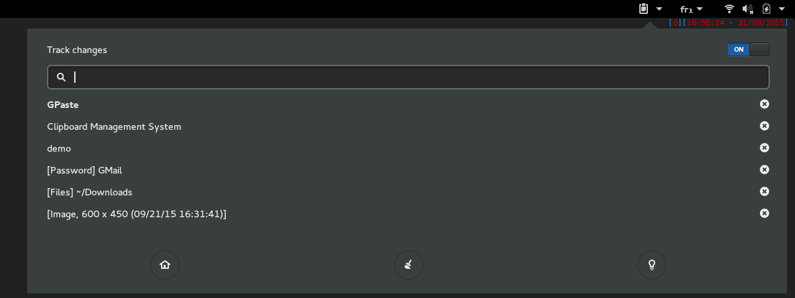
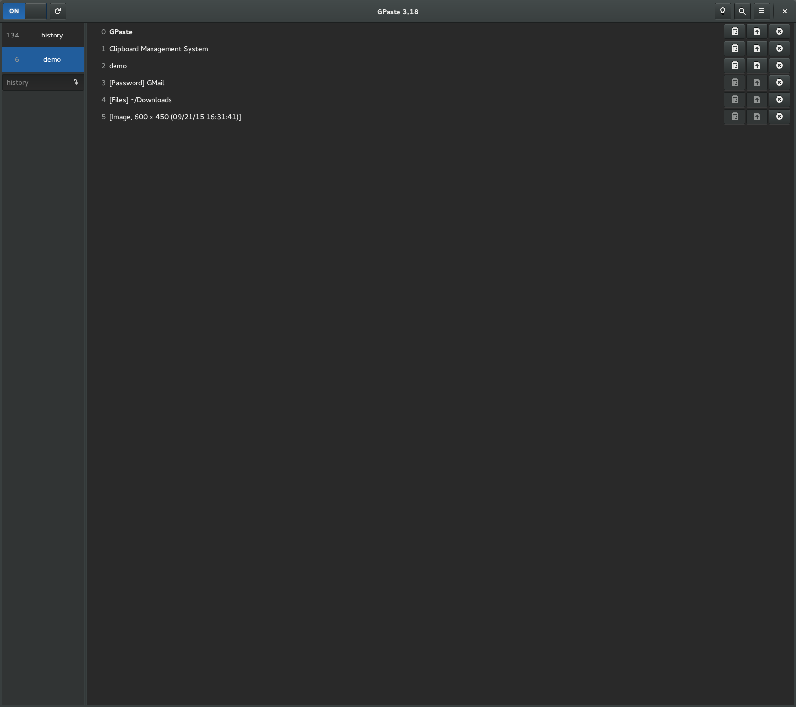
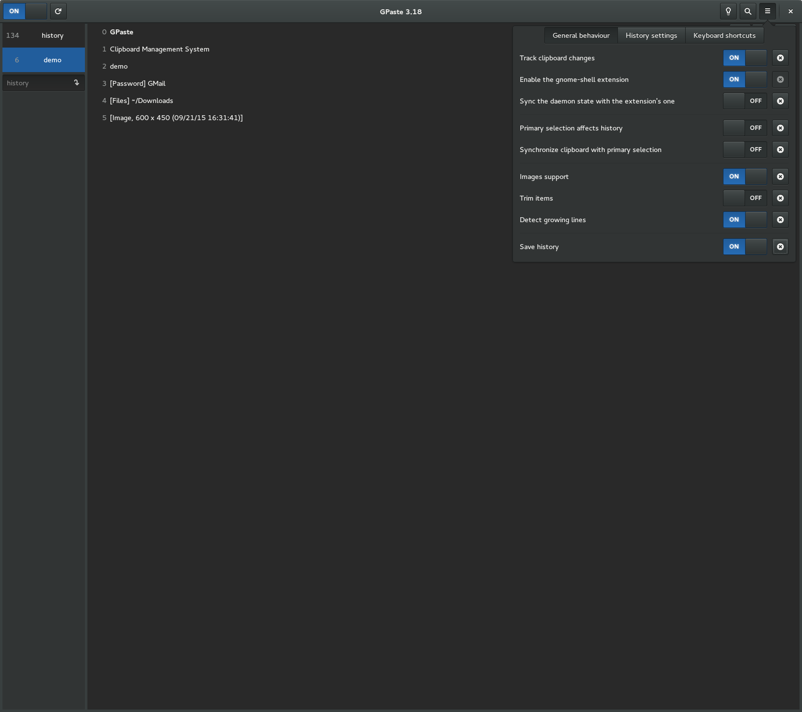
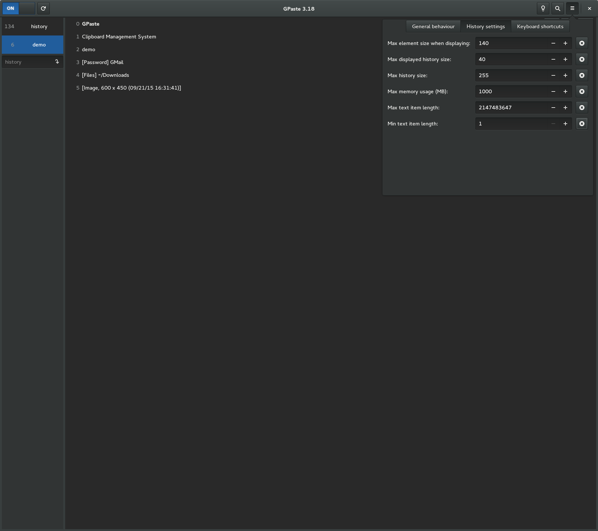
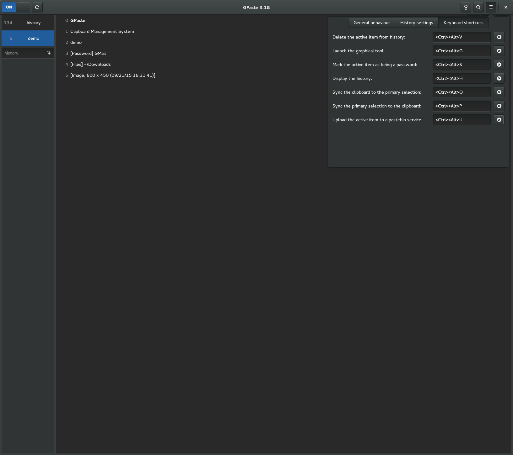

It's available [there](https://www.imagination-land.org/files/gpaste/GPaste-51.3.tar.xz), get it while it's hot!

This release targets GNOME 51.

If you're looking for the legacy applet/tray-icon, it's available [here](https://github.com/Keruspe/gpaste-applet).

## What's new?

This release is mostly about making what you already use more dependable.
Uploads go to paste.c-net.org by default, paste.rs having stopped taking them,
and GNOME Shell's storage dialogs explain their options. The graphical tool,
the editors and GNOME Shell's menu act on the items you see, copies made while
an application quits or GPaste restarts are kept, passwords leave the
clipboard when they should, and changes of storage and passphrase report what
they really did.

### New

- Upload to paste.c-net.org by default, paste.rs having stopped taking uploads
- Explain the import, cleanup and remember options in GNOME Shell's storage
  dialogs
- Have gpaste-client doctor offer to delete images no passphrase can read
- Draw the Pinned filter's star empty or full, as each item's star is

### Fixes

- Fix the graphical tool's searches, counts, status and merging going wrong
- Fix the item and password editors losing, misplacing or undoing what was typed
- Fix the graphical tool and the preferences staying behind on Wayland or
  opening apart from their launcher
- Fix GNOME Shell's menu and search freezing, stuttering, stretching, or showing
  or acting on the wrong items
- Fix copies and items vanishing, or another one than asked for being selected
- Fix passwords staying on the clipboard too long, or another item taking their
  place
- Fix histories deleted, backed up, emptied or switched wrongly, or listed with
  the wrong size
- Fix storage and passphrase changes failing, leaving files behind, taking a
  wrong passphrase or being misreported
- Fix gpaste-client doctor missing images left on another passphrase, which the
  next save deleted
- Fix SQLite histories stalling, keeping evicted items or losing edits
- Fix GPaste stopping, restarting or being replaced at the wrong time, and
  uploads left unanswered
- Fix the preferences refusing some shortcuts, and some translations blanking
  labels
- Fix the shell completions mangling, splitting or leaving out history names
  and paths, or slowing down
- Fix gpaste-client passing escape sequences to the terminal, or giving wrong
  reasons for failures
- Fix uploads through termbin being refused
- Fix what was searched for being written to the debug log

And don't forget to run `gpaste-client dr` aka `gpaste-client daemon-reexec` after upgrading GPaste to activate new functionalities ;)

You can then run `gpaste-client daemon-version` to check that the correct daemon is running.

## Screenshots

### Gnome-shell extension

### Graphical tool

